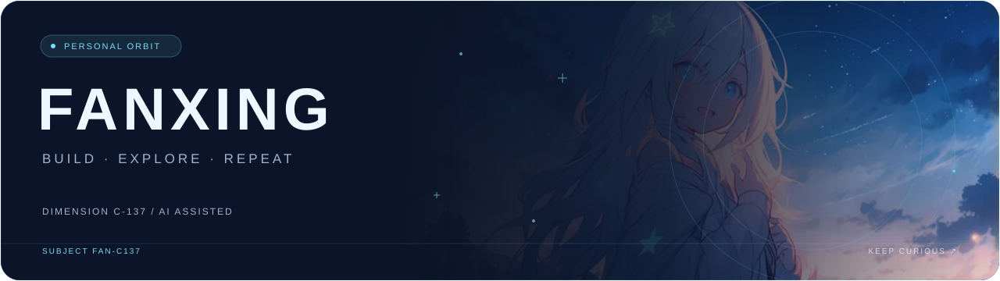

<picture>
  <source media="(prefers-color-scheme: light)" srcset="./assets/header-light.svg">
  <source media="(prefers-color-scheme: dark)" srcset="./assets/header-dark.svg">
  
</picture>

### 嗨，我是繁星 👋

把好奇心变成项目，把重复的事交给自动化。

**[个人站点](https://fanxing724.github.io)** &nbsp; · &nbsp; **[项目仓库](https://github.com/fanxing724?tab=repositories)** &nbsp; · &nbsp; **[卡片引擎](https://github.com/fanxing724/new-make)**

 

 

## 🛰️ 关于这颗星

喜欢折腾 AI、网站和服务器，也喜欢让它们自己好好工作。

- **AI 协作**：让 AI 帮忙解决问题，留点脑容量给新想法。
- **部署与维护**：从能跑到稳定运行，把过程整理成可复用的流程。
- **自动化实验**：少一点重复操作，多一点创造和摸鱼的时间。

> 让 AI 解决问题。避免重复造脑。

 

## ✨ 星轨记录

<table>
  <tr>
    <td width="50%" align="center" valign="top">
      <picture>
        <source media="(prefers-color-scheme: light)" srcset="https://fanxing724.github.io/new-make/fanxing724/stats.light.svg">
        <source media="(prefers-color-scheme: dark)" srcset="https://fanxing724.github.io/new-make/fanxing724/stats.svg">
        
      </picture>
    </td>
    <td width="50%" align="center" valign="top">
      <picture>
        <source media="(prefers-color-scheme: light)" srcset="https://fanxing724.github.io/new-make/fanxing724/activity.light.svg">
        <source media="(prefers-color-scheme: dark)" srcset="https://fanxing724.github.io/new-make/fanxing724/activity.svg">
        
      </picture>
    </td>
  </tr>
  <tr>
    <td width="50%" align="center" valign="top">
      <picture>
        <source media="(prefers-color-scheme: light)" srcset="https://fanxing724.github.io/new-make/fanxing724/languages.light.svg">
        <source media="(prefers-color-scheme: dark)" srcset="https://fanxing724.github.io/new-make/fanxing724/languages.svg">
        
      </picture>
    </td>
    <td width="50%" align="center" valign="top">
      <picture>
        <source media="(prefers-color-scheme: light)" srcset="https://fanxing724.github.io/new-make/fanxing724/streak.light.svg">
        <source media="(prefers-color-scheme: dark)" srcset="https://fanxing724.github.io/new-make/fanxing724/streak.svg">
        
      </picture>
    </td>
  </tr>
</table>

 

## 🚀 项目停靠站

<picture>
  <source media="(prefers-color-scheme: light)" srcset="https://fanxing724.github.io/new-make/fanxing724/repos.light.svg">
  <source media="(prefers-color-scheme: dark)" srcset="https://fanxing724.github.io/new-make/fanxing724/repos.svg">
  
</picture>

  <a href="https://github.com/fanxing724?tab=repositories">探索更多项目 ↗</a>

 

---

**宇宙没有 KPI，活着就不算宕机。**

DIMENSION C-137 &nbsp; · &nbsp; AI ASSISTED &nbsp; · &nbsp; CURIOSITY ALWAYS ON

  

数据卡片由 <a href="https://github.com/fanxing724/new-make">new-make</a> 自动更新 · <a href="https://fanxing724.github.io/new-make/">查看全部卡片</a>

